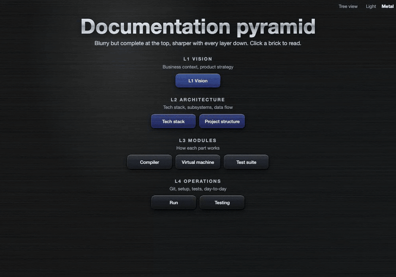
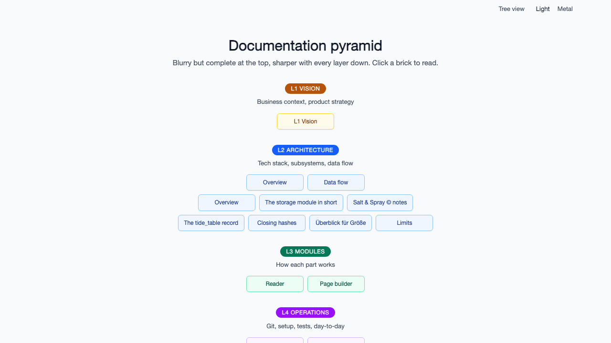
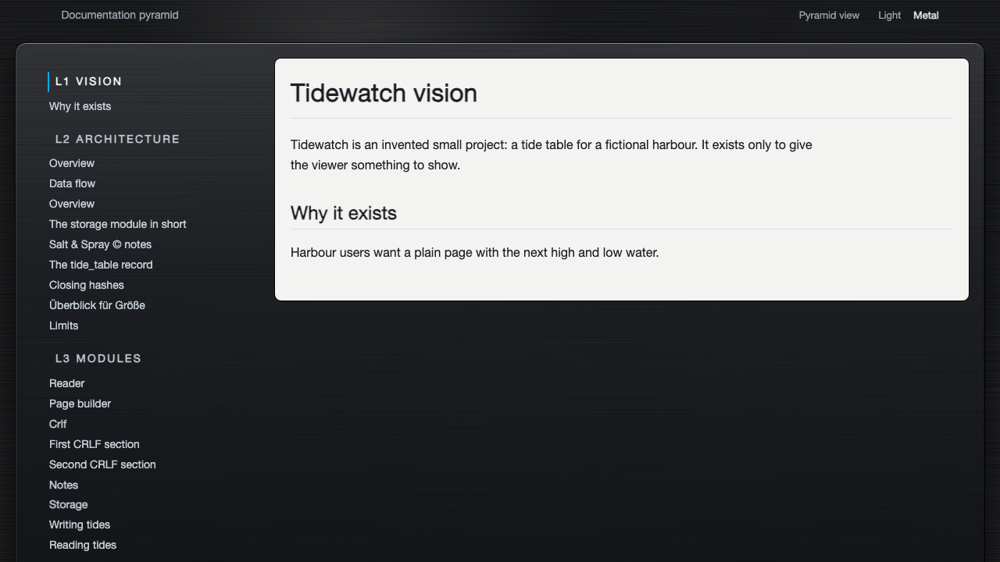

# Documentation Pyramid Viewer

**See your documentation pyramid grow, brick by brick.**

A small viewer for [Documentation Pyramids](https://github.com/DanielDornhardt/the-documentation-pyramid) : layered markdown docs (vision, architecture, modules, operations, decisions). For the story behind it and why it works, read the article: [The Documentation Pyramid](https://dornhardt.com/writing/the-documentation-pyramid).

This can visualize and render a Documentation Pyramid in multiple ways:

- A dynamic HTML view containing 
  - a browseable pyramid-view of the layers
  - A browseable classic / tree-style - view
- A static export of the two HTML styles above
- An export of the markdown contents as one big markdown file

We ship two different skins for the HTML view, a light and a metal skin because 🤘METAL🤘 i mean because that's our house style of course :D

**Live demos:** see it on two real code bases, with a skin switcher: 

- [NetHack](https://dornhardt.com/pyramid/nethack/) and 
- [Lua](https://dornhardt.com/pyramid/lua/)

The documentation pyramids behind them are in the [`samples/`](https://github.com/DanielDornhardt/the-documentation-pyramid/tree/main/samples) folder of the pyramid repository.

No dependencies to install, no build step. One vendored library file (markdown-it) is the only third-party code.

 

## Quick start

You need Node 20.11 or newer.

```
git clone git@github.com:DanielDornhardt/the-documentation-pyramid-viewer.git
cd the-documentation-pyramid-viewer
node viewer.js serve <docs-folder>
```

Open http://127.0.0.1:4000/. The server reads the docs folder on every request, so reload after you edit a file (or use `--watch`, see below). If port 4000 is busy, pick another with `--port N` (`--port 0` takes a free one).

```
node viewer.js export <docs-folder> <out-folder>                # static HTML, both views, light skin
node viewer.js export <docs-folder> <out-folder> --view tree --skin metal
node viewer.js markdown <docs-folder> book.md --toc --decisions # one big Markdown file
node viewer.js --help
```

The docs folder has to follow the layer names (`L1-vision.md`, `L2-architecture.md`, `L3-modules.md` and so on, see "Docs layout") or contain a `pyramid.json` that names your files. Any other folder shows an empty pyramid: `serve` prints a warning, and `export` and `markdown` write nothing and exit with code 1.

To try it without docs of your own: `node viewer.js serve tests/fixtures/pyramid` (invented text), or open one of the [sample pyramids](https://github.com/DanielDornhardt/the-documentation-pyramid/tree/main/samples) (Lua and NetHack) from the pyramid repository.

## What you get

* **Pyramid view.** The `##` sections of each layer as bricks, in rows that grow from the top: a picture of how much there is and where. A click opens the document in a dialog, scrolled to that section. Without JavaScript the bricks are ordinary links.
* **Tree view.** An index on the left, the document on the right. It opens on the first document (the vision). In serve mode it lives at `/_tree/`.
* **Light skin** (default): flat, slim, readable on a phone. **Metal skin:** dark brushed metal made from CSS and a procedural grain, no image files. Switch with `--skin`, with `?skin=metal` in serve mode, or with the switcher in the page header.
* **HTML export:** both views, relative links, opens from `file://` or any web server folder. **Markdown export:** one file, headings unchanged, links between documents resolved.



## Flags

| Flag                             | Applies to    | Meaning                                                                                                                                                                                                                                    |
| -------------------------------- | ------------- | ------------------------------------------------------------------------------------------------------------------------------------------------------------------------------------------------------------------------------------------ |
| `--port N`                       | serve         | Port, default 4000. `0` picks a free port and prints it.                                                                                                                                                                                   |
| `--host H`                       | serve         | Address, default `127.0.0.1`. Anything else prints a warning.                                                                                                                                                                              |
| `--allow-host NAME`              | serve         | Extra host name the server answers to (repeatable).                                                                                                                                                                                        |
| `--skin light\|metal`            | serve, export | Look, default `light` (`plain` is another name for it).                                                                                                                                                                                    |
| `--density comfortable\|compact` | serve, export | Height of the overview page, default `comfortable`. `compact` keeps the large title but tightens the gaps and puts the intro on one line, so more of the pyramid is in view, for example in a screen recording.                            |
| `--tokens <file>`                | serve, export | CSS file with your own design tokens, linked after the skin.                                                                                                                                                                               |
| `--watch`                        | serve         | Update open pages when files change. Off by default.                                                                                                                                                                                       |
| `--depth 2\|3`                   | serve, export | Deepest heading level in the tree index, default 3.                                                                                                                                                                                        |
| `--view pyramid\|tree\|both`     | export        | Which view to write, default `both`.                                                                                                                                                                                                       |
| `--skins light,metal`            | export        | Several skins in one export: a folder per skin, a skin switcher in every page that leads to the same page in the other skin, and an `index.html` at the top that opens the first skin. Use it instead of `--skin`. Good for a hosted demo. |
| `--layers <file>`                | all           | JSON file with a custom layer list.                                                                                                                                                                                                        |
| `--decisions`                    | markdown      | Append the decision records after the last layer.                                                                                                                                                                                          |
| `--toc`                          | markdown      | Insert a table of contents before the first document.                                                                                                                                                                                      |
| `--anchors html\|headings`       | markdown      | How links find their heading: explicit HTML anchors (default), or the automatic heading names, with no HTML in the file. Use `headings` for previews that ignore raw HTML (checked in Zed and Orca).                                       |
| `--force`                        | markdown      | Overwrite an existing output file.                                                                                                                                                                                                         |

Exit codes: 0 done, 1 run-time error or nothing written (no layers found), 2 wrong arguments. `export` replaces files of the same name and never deletes, so export into an empty folder.

## Docs layout

Without configuration the viewer looks for these and leaves out what is missing:

| Layer            | Default path                                                     |
| ---------------- | ---------------------------------------------------------------- |
| L1               | `L1-vision.md` (one brick)                                       |
| L2               | `L2-architecture.md`, plus an optional folder `L2-architecture/` |
| L3               | `L3-modules.md`, plus an optional folder `L3-modules/`           |
| L4               | `L4-operations.md`, plus an optional folder `L4-operations/`     |
| Decision records | `adr/` (one brick per file, shown as a separate block)           |

A layer file and the folder with the same name are **one layer**. Small modules stay as `##` sections of the layer file; a module that outgrew about 100 lines moves into its own file in the folder. Heading levels are the same everywhere: the layer file has one `#` title, every module is a `##` with `###` sections, and a broken-out file has no `#` and starts at its module's `##`. The viewer shows such a file with its title as the single `h1`.

```text
docs/
  L1-vision.md
  L2-architecture.md
  L3-modules.md          <- one # title, each module a ## section (one brick each)
  L3-modules/            <- broken-out modules only, no index.md
    harbor-routes.md     <- starts at "## Harbor routes"; one brick, opens from the top
  L4-operations.md
  adr/                   <- decision records, one # title each
```

Older layouts work too: a layer folder with its own `index.md` makes bricks from the index sections (`"bricks": "index"`), and every file's sections can be bricks with `"bricks": "headings"`. Documents that make no brick are not lost: the tree view, document pages and both exports keep every document, and the count is printed on the command line and shown under the picture.

### `pyramid.json`

To use other names, put a `pyramid.json` in the docs folder or pass `--layers <file>`:

```json
{
  "layers": [
    { "id": "L1", "label": "Vision", "path": "vision.md", "kind": "file" },
    { "id": "L2", "label": "Modules", "path": "modules", "kind": "folder",
      "bricks": "index", "include": ["modules/glossary.md"] },
    { "id": "stories", "label": "Story archive", "path": "story-archive", "kind": "folder",
      "bricks": "file", "description": "One brick per finished story" }
  ]
}
```

Keys: `id`, `label`, `path`, `kind` (`file` or `folder`), and optionally `description` (a line under the label), `bricks` (`modules`, `index`, `headings` or `file`), `include` (extra documents whose `##` sections also make bricks in `index` mode) and `decisions` (`true` for a decision-record block). A mistake in the file stops `export` and `markdown` with exit code 1, and `serve` with a one-line message. Examples of every key are in `tests/discovery.test.js`, `tests/bricks.test.js` and the fixtures under `tests/fixtures/`.

## Your own look

A skin is three stylesheets, linked in this order: `skins/pv-base.css` (all structure, reads tokens only), the theme (`skins/light.css` or `skins/metal.css`, which set the tokens), and your own file when you pass `--tokens my-tokens.css`. Later files win.

```css
:root {
  --pv-bg: #fdf6e3;
  --pv-tint-0: #fff4cc;
  --pv-tint-0-text: #5a3b00;
  --pv-font: "Georgia", serif;
}
```

The token names and their defaults are in the two theme files; only the tokens are a stable interface, the selectors in the base file may change. Set a motion token (`--pv-dur-*`) to `0ms` to switch that animation off. A tokens file is not contrast-checked: you own the contrast. Limits: a regular UTF-8 file under 256 KB.

## Watch mode

`node viewer.js serve ./docs --watch` makes open pages follow the files. On the pyramid overview new bricks grow in, removed ones fade out and the others glide to their new places, without a page reload; an open dialog, style files and the tokens file update in place; other pages reload when a change concerns them. Reduced motion, a hidden tab or a very large change apply the update at once. It is off by default and meant for your own computer: each open page keeps one event-stream connection to the server. To record a demo, serve an empty folder with `--watch`, start a screen recorder, and run `node tools/demo-grow.js <source-docs> <that-folder>`: it adds the layers and their sections one by one over about twenty seconds (the animation above was made this way, from the Lua sample of the pyramid repository, with `--density compact` so that the whole pyramid fits a 16:9 screen).

## Security notes

Serve mode listens on 127.0.0.1, answers only GET and HEAD, rejects requests whose Host header is not its own address (use `--allow-host` when you reach it by name), resolves every path with `realpath` and keeps it inside the docs folder. Raw HTML in markdown is escaped, on purpose. Responses carry a Content-Security-Policy without inline script. Files over 2 MB are not read. Export refuses to write through a symbolic link at a target path.

## What was checked, and what was not

* **Automated:** over 600 tests (`node --test tests/*.test.js`) on Node 20.11.1, 24.12.0 and 26.3.0, covering layer discovery, headings and slugs, link rewriting, serve mode (including path traversal), both exports, skins, accessibility structure, the watcher, and text contrast computed from the tokens. Test fixtures contain invented text only. Node 22 was not run and is not claimed.
* **By hand, in headless Chromium on one macOS machine:** the overview, dialog, tree view, watch-mode animations and the skin switcher, in both skins, served and exported. The exporters were also run on a dozen real documentation pyramids.
* **Not checked:** Firefox, Safari, Windows, screen readers, keyboard-only use beyond the focus styles, and the look on other platforms' font rendering (the metal fonts are bundled; the light skin uses system fonts).

## Known limits

* **Markdown:** task lists, footnotes and GitHub alert blocks are not supported by the vendored library. Relative images are not served or copied.
* **No** search, editing, authentication, plugins, PDF export (print the exported HTML) or non-markdown sources.
* **The dialog needs JavaScript** and a browser with `dialog.showModal`; without it the bricks open the document pages. The tree view has no dialog. The export embeds every document in `index.html` so that the dialog works from `file://`, which makes that file large for big pyramids.
* **Phone layout:** below about 30rem the bricks wrap two per line, so the triangle shape is a desktop shape.
* **Tree index:** the wide-screen index relies on `::details-content` (recent Chromium); elsewhere it stays behind its toggle.
* **Metal skin:** the light on the lettering and bricks is static, and it does not match the grain of any other site pixel for pixel. The light skin names Geist first and falls back to your system fonts; it bundles no fonts.

## Development

Run the tests with `node --test tests/*.test.js` (list the files: a plain `node --test` also picks up test files in stray copies of the repository inside the folder). `node tools/measure.js` measures request times on a generated tree and is not part of the test run. The code is `viewer.js` (pure functions and the entry point), a few modules in `src/` (server, pages, export, command line, watcher, Node version guard) and two browser scripts in `assets/`.

`tools/refresh-pyramid.js` keeps the routing table of a pyramid's root `index.md` current and checks the docs against the house rules; a copy ships with the [documentation pyramid](https://github.com/DanielDornhardt/the-documentation-pyramid). Its reference is `tools/refresh-pyramid.md`.

**Refreshing the vendored markdown-it.** markdown-it has published denial-of-service advisories (all fixed in 15.0.3 or later). The pinned version is 15.0.3. When a new one appears: replace `vendor/markdown-it.esm.min.mjs` with the fixed ESM minified bundle, update the version, size and sha256 in `vendor/NOTICE.md`, check that the bundled licences are still listed, and run the tests (`tests/vendor.test.js` fails if the file changed without a matching note).

## Licence and credits

MIT, see [LICENSE](LICENSE). The vendored markdown-it keeps its own licence in `vendor/NOTICE.md`. The metal skin bundles IBM Plex Sans and IBM Plex Mono (official, unmodified files, SIL Open Font License 1.1, see `vendor/fonts/`); the HTML export embeds them, so the metal look does not depend on installed fonts.

If you use the viewer or the [documentation pyramid](https://github.com/DanielDornhardt/the-documentation-pyramid) in your own project, your own docs, an article or your own shopfront material, please link back to the original repository. This is a request, not a condition of the licence. A line like this is plenty: "Built with the Documentation Pyramid (https://github.com/DanielDornhardt/the-documentation-pyramid)".
